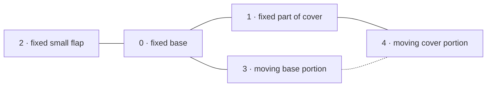

# Which parts of a folded sheet must move?

Mathematical architecture review of Origami Lab at `6ed4cbc`, including PR #30 (`580bdb5`) and the subsequent tactile Unfold action. The object of study is a verified, flat, zero-thickness sheet undergoing one rigid 180° swing about a fixed line. [PR #30](https://github.com/tsincla-purdue/origami-lab/pull/30) · [Physical contract](SOUNDNESS.md) · [Design principles](PRINCIPLES.md)

**A small closure explains which material must follow a grab under specified assumptions.** A material weld reaching into the moving half-plane forces equal motion on its two sides. A contacting ply on the departure side forces a *directional* inclusion if the swing must launch through that surface without passing through stationary paper. These two rules explain the deep dog-ear. They give a lower bound on the moving material. Whether one hand can drive it, whether its hinge can close, and whether the user meant to turn the entire half-plane are separate questions.

Two observations determine the architectural recommendation. In the three-flap construction, two proposed operations produce **identical trial states**, but only the whole-stack operation is certified. In a second, reproducible construction, two legal histories produce the **same physical flap and local stack** but a different clearance verdict for the same explicit swing. The first calls for naming the requested operation. The second calls for a clearance argument that survives an equivalent subdivision. Neither requires a general constraint solver. The reproductions are in Part IV.

## Part I — Current model

### What persists

A facet has a convex polygon in the coordinates of the original sheet, a current planar isometry, a material-partition ID, and a numerical layer rank. The determinant of the isometry gives its front/back parity. A split retains the parent's ID on the fixed child and allocates a fresh ID to the moving child. A facet moving intact keeps its ID. Crease segments and marks live in original material coordinates, so they survive changes of placement and can outlive the partition that created them. A crease mark alone does not divide the current mesh. [Geometry](../vendor/origamio/src/geometry.ts) · [Facet representation and fold](../vendor/origamio/src/paper.ts)

Material adjacency is recovered from shared positive-length segments of the original polygons. In a flat, untorn state the two transforms coincide there. The rigid code recognizes equal transforms or a reflection across the placed edge, reports inconsistent neighbours as tears, and caches the result per state. Its hinge list includes coplanar seams. Two projected polygons may coincide everywhere and share no material edge. The rendering routines for partially opened panels do not certify a lab move. A turnover mirrors the *view*, reverses ranks there, and leaves the intrinsic mesh available for replay. [Hinges and tears](../vendor/origamio/src/rigid.ts) · [Paper pose](../src/lab/paper-pose.ts)

### From a grab to an experiment

1. **Acquire material and geometry.** Hit testing identifies an exposed point or supporting segment. At a corner, `cornerPackets` starts with the top face, grows a common positive-area overlap incident to the grab, and offers accumulated prefixes that are edge-connected in the **pre-fold** mesh. Boundary-only contact gives no extra stack depth. A point-to-point drag proposes the perpendicular bisector, with the grab on the moving side. Snaps, line constraints and recognized openings can supply competing drafts. Default corner grabs enable inference. Selecting a packet count or Whole stack explicitly specifies material scope. [Hit testing](../src/playground/geometry.ts) · [Gestures](../src/playground/gestures.ts) · [Corner packets](../src/lab/packets.ts)
2. **Generate hypotheses for each fixed axis and side.** `packetCandidates` clips each displayed facet to the moving half-plane and uses its parent ID as a node if the portion survives clipping. Its graph named `required` contains bidirectional welds reaching into that half-plane and lower-to-upper arcs for positive-area overlaps there. The `joins` graph also admits bidirectional welds lying on the new axis. A weld entirely on the fixed side adds neither link. The generator tries the raw top singleton, the `required` reachability closure of each active local prefix, and the maximal `joins` expansion from the top. A set must be reachable from the top *within that set* using directed joins. IDs are sorted, deduplicated and offered smallest first. This produces at most the number of local seeds plus two hypotheses per geometry. [Packet inference](../src/lab/packet-intent.ts)
3. **Try the actual move.** `interpretDraft` submits each proposal to `apply`. The engine translates the displayed axis, side, layer selector and exterior placement back through the pose. With a proper subset of parent IDs it calls `foldPacket`, which splits the selection, reflects the moving pieces and restores the stationary stack. All parent IDs, or a whole-stack move without a packet, use the whole-sheet fold path. The trial contains *post-fold* moved IDs. Validation inspects this trial before returning a verified successor. A failed trial returns the input state. [Interpretations](../src/playground/intent.ts) · [Fold execution](../src/lab/packets.ts) · [Validation](../src/lab/engine.ts)
4. **Resolve intent and record.** Within a geometry search, accepted interpretations survive. If none succeed, an unverified trial takes precedence over a rejected one. Across rival drafts, opening and snap policies also matter. The browser can present alternatives. The tactile hand reports resistance or competing interpretations and commits a uniquely resolved action through the same interpreter. A failed tactile release can leave the entire experiment untouched. An explicit recorded attempt can retain a refusal with an unchanged snapshot. Import starts from a fresh verified sheet and replays the operations, checking saved outcomes and states. [Browser commit](../src/main.ts) · [Tactile hand](../src/lab/tactile.ts) · [Experiments](../src/lab/experiment.ts)

## Part II — A combinatorial formulation

### Material incidence and local layers

Let $D$ be the original material disk with a finite polygonal subdivision. A material point is a point of $D$, including points on shared edges. Each face $f$ has a placement $T_f$ which is an isometry and agrees with the neighbour's placement on their common material boundary. Write $P_f=T_f(f)$. Incidence, boundary identifications (including split edges and their endpoints), side orientation and the placements suffice to recover material continuity. An implementation can store that incidence or derive it from the original polygons. Persistent material coordinates and child-to-parent correspondence support comparison across steps. Reconstructing a saved experiment also needs identifiers, annotations and operation history.

Overlay the boundaries of the $P_f$ in the view. For each open two-dimensional cell $c$, take the fibre of material preimages of an interior point. Equip that fibre with the bottom-to-top list of the plies covering $c$. A resolved physical stack gives a total order **within a cell**. Partial orders can express incomplete information if the model ever admits it. Across adjacent cells, comparisons of continuing plies must agree wherever their overlap continues. On edges and vertices use the incident cell lists and the actual material welds. Sampling just the line misses which two sheets a hinge joins.

Straight convex facets have convex pairwise intersections. Where the same two plies overlap on a connected interior, continuity of layer order prevents them from swapping places there. An intervening third ply can enter or leave the local list. A global rank assignment supplies a compact compatible family of lists in today's engine. Its ordering of disjoint plies has no physical observation at their locations. A single global extension exists exactly when the union of the strict local precedence constraints on the chosen facet names is acyclic. For instance, three comparisons $a<b$, $b<c$, $c<a$ at **three different** pairwise overlaps would defeat global ranks without creating a cycle in any one local stack. This is an abstract test of the representation. Reachability of such a sheet through the lab's exterior folds is unestablished. Those folds already construct a global extension by preserving stationary ranks, reversing moving ranks and placing the moving block at one extreme. Keeping ranks for this class costs little. Queries about obstruction still need the *location* of the comparison.

### Fix the motion before taking a closure

Fix an oriented line $L$, moving half-plane $H$ specified by side $\sigma$, departure surface $d$ (toward the displayed top or bottom), and a seed $S$ of grabbed moving portions. Fix a single synchronous rotation with stationary material held flat. For each face make the prospective portion $u_f=f\cap T_f^{-1}(H)$ if it has positive area. Its Boolean variable $x_f$ says whether that portion rotates. The opposite-side remainder stays fixed even when $x_f=1$. Axis points lie on the fixed set of the rotation. Facets wholly outside $H$ have no moving variable. Unselected active portions stay fixed as part of that hypothesis.

* **Material equality.** If a common weld has positive length in the open moving half-plane, impose $x_f=x_g$. At any of its off-axis points, a nontrivial rotation displaces the point and the identity leaves it fixed. Giving its two incident faces different actions would give one material point two positions. A weld entirely on $L$ permits relative rotation. A weld on the fixed side constrains the fixed remainders. Projected contact alone supplies no equality.
* **Departure order.** In each launch cell in $H$, a moving subset must be a suffix of the local bottom-to-top list for a topward swing, or a prefix for a bottomward swing, under the model's exposed-departure rule. For topward motion impose $x_f\Rightarrow x_g$ for each covering $g$ above $f$ in that cell. Immediate neighbours in a *complete cell list* suffice by transitivity. If an upper stationary ply covers an open patch of a lower mover, the initial separating motion would pass through that ply in the local stack order. The argument assumes resolved precedence, positive-area contact, the stated direction and a common swing. A backside swing reverses the arrows. Tangency along an edge gives no area implication.

Let $E_d$ contain the two directed arcs of each equality and the directed launch implications under these assumptions. Define
$$
C_d(S)=\{v\mid \text{a directed path in } E_d \text{ leads from some }s\in S\text{ to }v\},
$$
including paths of length zero. Every set satisfying the implications and containing $S$ contains $C_d(S)$, by induction on path length. The reachable set itself satisfies every such implication. Hence it is extensive, monotone and idempotent, and is the unique least solution of **this subsystem**. With a prohibited set $F$, a solution of the subsystem exists exactly when $C_d(S)\cap F$ is empty. The material-only closure uses just weld equalities and is independent of the swing surface. Strongly connected components of $E_d$ share a truth value in every solution. Only the weld equalities assert a physical attachment.

PR #30's overlap arc therefore has two readings. For a specified exposed topward launch, moving the lower patch entails moving its contacting upper patch under that rule. In the code the arc expands a *proposal*, the raw singleton is still tried, and the expanded proposal may fail. As an unconditional material dependency it would be wrong for a bottomward launch, and as a certificate for the expanded packet it would miss clearance and actuation. Current inference takes the displayed ranks and assumes an outward topward grab. Its signature has no independent placement argument. The explicit fold API can ask for an underside swing.

### What “must” and “may” quantify over

Fix the same geometry, surface, grip or whole-stack instruction, and any explicitly fixed material. Let $\mathcal A$ be the family of admissible *moving material sets* under those assumptions. When it is nonempty, its intersection is the forced material, the complement of its union is forced stationary, and the union minus intersection is optional. Optionality requires both an interpretation that moves the region and one that leaves it fixed. Opposite-side material is stationary by construction. If no admissible interpretation exists, report infeasibility. Avoid vacuous claims that all regions must move.

In practice we have accepted witnesses, rejected proposals and unverified proposals, and the generator can omit proposals. Two accepted witnesses can establish optionality *within the supported model*. One can establish possibility. A forced assignment can follow from a proved implication or exclusion across all allowed hypotheses. When the evidence settles neither possibility nor necessity, record **undetermined**. An unverified proposal contributes no witness in either direction. An unknown verdict is an evidence status, distinct from the physical choice between two feasible packets.

### What remains after closure

A moving/fixed boundary on a weld requires incidence on the axis. Clearance then depends on the *triple* of two incident plies and a crossing ply. For example, if that weld closes, an uncut stationary ply spans its actual segment and would lie locally between its incident plies at landing, that combination is forbidden. Equivalently, for incident trial portions $p,q$ and cover $b$, exclude the conjunction of $m_p \ne m_q$, $b$ remaining uncut and fixed, $b$ spanning their common hinge interval, and $b$ lying between $p$ and $q$ over the closing overlap. Here $m$ denotes post-split motion, so a new weld can join two children of one selected parent. Changing a selected parent can split the putative blocker or change the landing stack. In a finite model this is a guarded exclusion over selections and derived trial geometry. Encoding an unconditional edge from a hinge neighbour to every projected crosser loses permitted swings.

A partial one-grip certificate also requires the moving material graph to be edge-connected. A connected extension can include a path through either of two possible connecting components. The condition “choose some connecting path” can be disjunctive. Even abstractly, two connected sets containing the seed and a second required node can intersect in just those two disconnected nodes. Thus the intersection of all feasible extensions need not itself be feasible. This is a graph example about connectivity, independent of whether the current test suite realizes the diamond of paths. Fixed-direction Horn implications can describe propagation. A mode choice, guarded exclusions and a connectivity predicate suffice to express the remaining *kinds* of checks here. There is no need to compile them all into a directed graph or a SAT solver.

For an exactly synchronous half-turn, an off-axis moving point at distance $r>0$ from $L$ is at signed height $\pm r\sin\theta$ for $0<\theta<\pi$. This explains why two planar projections can cross during the swing while occupying different heights. This calculation presupposes the synchronized motion, preserves the moving stack internally and says nothing about which disconnected pieces a hand can drive. Contact at launch, hinge incidence on the axis and layer order on landing still need evidence. The runtime contract covers its supported certificates and numerical checks. General continuous collision clearance remains open.

## Part III — What the existing rules establish

The first applicable verdict wins. A fold returning `blocked-hinge` may also violate departure order. A table entry describes the test actually reached, under the documented operation. [Validator](../src/lab/engine.ts) · [Numerical and audit policy](SOUNDNESS.md)

| Check | Current decision and mathematical force |
| --- | --- |
| Request, source and domain | Malformed moves, stale facet IDs, inconsistent line references and empty motion can be rejected. Unknown state provenance, unsupported motion, the uncertain vertex band and the 128-facet budget give **unverified**. These include API and numerical restrictions. A proper partial selector containing an inactive parent gives `packet-side` even if simply omitting that name would describe sensible motion. A whole-stack fold must leave fixed paper. |
| Material continuity | `tears(trial.state)` yields **rejected / torn-hinge** if a detected material edge pulls apart. Continuity is necessary. Detecting no tears is a tolerance-based endpoint check. Very short contacts and partial shared segments depend on the weld finder. The moving/fixed interface must also contain at least one weld, with every such weld on the proposed axis, for the certificate in `inspectPacket`. |
| Blocked hinge | For partial or inside trials, find an unchanged, uncut cover spanning both sides of the line. In the trial stack its rank must lie strictly between the closing plies. Require positive common overlap and a chord overlapping the *actual welded segment* by positive length within tolerance. This witnesses incompatible local sandwiching and gives **rejected / blocked-hinge**. A global intermediate rank or a crossing somewhere on the infinite line alone would give false rejections. Absence of this particular witness leaves other obstructions possible. |
| Endpoint and layer audit | `inspectPacket` reconstructs selected children by clipping in folded space, reflects movers, matches ordered vertices and expected IDs, verifies equal-rank classes, stationary order, reversal of moving order, and exterior placement. The sum of projected **facet** areas must equal sheet area. Failures here give **unverified / packet-audit**. Isometry, per-parent conservation and local stack compatibility are necessary. Aggregate area alone can hide compensating overlaps and gaps in material space. Global rank comparison and exact child/vertex conventions are stronger representation contracts. Reconstruction shares some geometry primitives with the producer. |
| Connectivity | `checkPartialMotion` tests the induced graph on **post-split moved children**, using material welds only. Failure gives **unverified / disconnected-packet**. This is a conservative certificate for a single controlled packet. The whole sheet can stay connected through stationary material even when the movers have two separate hinges. A whole-stack operation may drive both. Pre-fold grab connectivity and directed reachability through covers prove neither post-split connectivity nor actuation. |
| Buried packet | For each selected moving portion, a positive-area overlap with an unselected stationary facet on the swing side gives **rejected / buried-packet** on the partial path. The inequalities are inclusive of equal ranks. A valid resolved positive-area stack should already distinguish those ranks. This is the launch obstruction for a rigid exterior swing with the cover fixed. Top and bottom placements have opposite tests. |
| Hinge clearance | For unselected stationary material crossing a moving/fixed weld segment, v2 can certify a *new split* when both incident children have the same source and the crosser stays on the opposite side of both the launch rank and the landing pair. Otherwise it can return **unverified / hinge-cover**. The v1 replay rule conservatively withholds clearance for such crossings. This is a sufficient local witness with a known false negative for certification, shown in Part IV.G. |
| Supported success | A whole-stack half-plane passing the applicable checks receives **accepted / simple-fold**. An explicit partial packet must additionally pass connectivity, burial and clearance for **accepted / packet-fold**. Inside placement or a rank-only partial move can produce an obstruction first, otherwise `unsupported-stack`. Neither success code asserts arbitrary 3D foldability. |

Tolerance can also lead to an actual **rejected** result for an exact nonempty mathematical move. A corner triangle of side $10^{-6}$ has positive area but falls below the clipping cutoff and yields `no-op` in the audit sweep. Geometry uses distance $10^{-9}$, area $10^{-10}$ and an on-line band $10^{-7}$ on the unit sheet. The endpoint audit uses $10^{-8}$ distance and area, and the weld finder uses $10^3\,\mathrm{EPS}$ times sheet size. An area threshold, a distance band and a bound on facet count answer different questions. A missed candidate, an unverified certificate and a model-rule rejection should be counted separately. [Threshold experiments](SOUNDNESS.md) · [Rigid neighbour recovery](../vendor/origamio/src/rigid.ts)

## Part IV — Constructions that distinguish the rules

Coordinates below are in the front view of the unit square unless stated otherwise. Bracketed IDs refer to **parents before the proposed move**. For the dog-ear comparisons, one can reproduce the table by enumerating parent subsets containing the grabbed top facet, calling `validate` for each on the same perpendicular bisector, and separately running `packetCandidates` and the tactile drag. This enumerates API requests for these small examples. The user's grip can distinguish requests that share an endpoint.

### A. A free upper flap

Fold $(1,1)$ to $(0.5,0.5)$, then drag its exposed tip from $(0.5,0.5)$ to $(0.64,0.64)$. The old attachment stays behind the new line. Both parents have material on the moving side, but the flap lies on top. The local choices are `[1]` and `[0,1]`. Directed reachability from the grabbed top yields only `[1]`. The one-flap operation is **accepted / packet-fold** and the base stays put. On this same axis, an explicit `[0,1]` is **accepted / simple-fold** and moves part of the base too. Thus enumeration of all validator-accepted selections and interpretation of a one-flap grab have different answers even with two facets. Symmetrizing every cover arrow would lose the light grab. In another regression, two material choices, `[2,3]` and `[1,2,3]`, both validate on the same axis and move different material. Picking the smallest by default would hide the second choice. [Packet intent tests](../tests/packet-intent.test.ts) · [Explicit packets](../tests/packets.test.ts)

### B. The deep dog-ear

Fold $(1,0)$ to $(0.5,1)$. The old weld $0$–$1$ runs along $y=0.5x+0.125$ across the sheet. Drag $(0,1)$ to $(0.84,0.12)$. The moving side of its bisector satisfies $h(x,y)=0.88y-0.84x-0.14>0$. On the old weld, $h=-0.40x-0.03<0$ throughout. **No point of that attachment is pulled by this swing.** Hinge-only propagation correctly stops at the seed, yet misses a layer obstruction elsewhere. The reflected tip $(0.5,1)$ is on the moving side, and the clipped portions of upper 1 and lower 0 overlap in about $0.17326$ square units. The grab itself sees only 0.

| Proposed parents | New relationships | Verdict |
| --- | --- | --- |
| `[0]` | 0 splits. Uncut 1 remains between the stationary base and moving child 2 across the closing 0–2 weld. The old weld survives. | **Rejected / blocked-hinge** after the tear check passes. |
| `[0,1]` | The launch overlap gives $0\Rightarrow1$. Both parents split on the same displayed line. Old 0–1 remains on the fixed side, and 0–2 and 1–3 are new hinges. | **Accepted / simple-fold**. Bottom-to-top IDs are 0, 1, 3, 2. The moving material is children 2 and 3. |

The corrected generator tries both rows. The second proposal changes the packet while preserving the grab, freehand axis, side and validator. Along a drag all the way to $(1,0)$, part of the old weld already reaches the moving side. Success at that endpoint alone would not test the PR's discovery. [Original reproduction and trial details](https://github.com/tsincla-purdue/origami-lab/pull/30) · [Deep dog-ear tests](../tests/deep-dog-ear.test.ts) · [Pointer regression](../tests/playground.browser.mjs)

### C. What “shallow” means

| First upper-edge landing, then target from $(0,1)$ | Moving-side evidence | Automatic candidates and verdict |
| --- | --- | --- |
| $(0.55,1)$, then $(0.55,0.45)$ | Parent 0 contributes area $0.15125$. Parent 1 contributes zero area. The old weld stays fixed. | Only `[0]`, **accepted / packet-fold**. Naming both parents explicitly also accepts the same footprint via the whole-stack path. |
| $(0.5,1)$, then $(0.84,0.12)$ | Both parents contribute area, with an open patch of 1 above 0 and a fixed old weld. | `[0]` rejected, `[0,1]` accepted, as in B. |

There is no universal drag-distance threshold. The events are the weld entering the moving half-plane and a launch cell of positive area appearing on the swing side. Their locations depend on the first fold, the new axis and the pose. Within a nondegenerate open range the combinatorics can remain constant while the areas vary. Changing snap axes can also change the answer. The reverse-face regression exercises the displayed rank reversal, and two distinct admissible snapped axes after a first landing of $(0.2,1)$ yield tactile **unverified / competing-interpretations**. [Parameter and pose cases](../tests/deep-dog-ear.test.ts)

### D. Three flaps, two moving portions

Start from B's first fold. Before the deep drag, fold a small flap from $(1,1)$ to $(0.94,0.94)$. Parent 2 now lies wholly on the stationary side of the deep axis. The local grab still sees only 0. Enumerating **all four** pre-fold ID sets containing 0 on that one axis gives the following results.

| Selected parents | Effective moving parents | Generated | Validator result |
| --- | --- | --- | --- |
| `[0]` | 0 | Yes | **Rejected / blocked-hinge** |
| `[0,1]` | 0, 1 | Yes | **Unverified / disconnected-packet** |
| `[0,2]` | 0 | No | **Rejected / packet-side** because the proper subset names inactive 2 |
| `[0,1,2]` | 0, 1 | No | **Accepted / simple-fold** |

In the middle two-ply proposal, moving children 3 and 4 are attached to stationary parents 0 and 1, respectively. They have no weld to one another. The retained stationary welds are 0–1 and 0–2. Calling the geometric constructors directly gives equal trial states for `foldPacket(...,{0,1},...)` and the whole-sheet `fold`, including moved IDs 3 and 4, layer order 0, 1, 2, 4, 3, and all material polygons and creases. Adding ID 2 supplies **no moving paper and no connecting weld**. In `evaluate`, naming every parent selects the synchronous whole-stack certificate. Naming a proper subset invokes the one-packet connectivity requirement.

The trial's weld graph makes the distinction visible. Solid lines are shared material segments. The dotted line records projected overlap.



The generator is incomplete relative to all accepted API operations. Its active-node universe deliberately omits 2. It has already found all moving material for the accepted footprint. Adding another material dependency cannot explain the difference in verdicts. The open interaction question is whether a grab may propose a separately labelled whole-stack action here. Explicit whole-stack intent supplies an answer today. The implicit tactile release reports the unverified partial proposal and keeps the previous experiment. [Three-flap regression](../tests/deep-dog-ear.test.ts) · [Validator dispatch](../src/lab/engine.ts)

### E. Reversing a compound fold

After B, the moved pair 2 and 3 shares an axis and a region of projected contact. Its material graph has two components. Dragging the landing back toward the grab recognizes the previous action but gives **unverified / opening-disconnected**. A one-grip opening checks the exposed facet, packet exposure, a common attachment axis and edge connectivity. A fixed upper cover can also yield **rejected / opening-covered**. Explicit **Unfold** uses the recorded accepted operation and verifies the latest active fold and matching immutable mesh. On B it restores the first fold's mesh, keeping current material marks, crease records, ID allocation and pose. **Undo** removes a history entry, including its effect on annotations. A legal discrete inverse, a graspable opening and a collision-free general inverse path are three different claims. [Opening recognition](../src/playground/gestures.ts) · [History reversal](../src/lab/experiment.ts) · [Compound tactile Unfold](../tests/tactile-unfold.test.ts)

### F. Genuine obstructions and a permitted crossing

* **Tear.** Half-fold the square along $x=1/2$, then select only the top ply for a transverse half-fold along $y=1/2$. The old vertical weld reaches into the moving half-plane. Its two sides would separate. The explicit singleton is **rejected / torn-hinge**. In the dog-ear-then-half-fold regression, automatic inclusion of the attached parent repairs this particular failure on the same axis.
* **Burial.** On the half-fold with the stack on the right, select lower parent 0 to swing back about the existing vertical hinge. With top placement it is **rejected / buried-packet**. The same parent and axis with bottom placement give **accepted / packet-fold**. Material incidence alone cannot distinguish those requests.
* **Sandwiching and clearance.** On the right-to-left half-fold, cutting the *lower* ply at $x=1/4$ toward the top leaves the other ply threaded through the closing hinge, **rejected / blocked-hinge**. Cutting the *upper* ply at $x=0.2$ with the lower sheet behind both incident pieces gives **accepted / packet-fold**. A blanket veto on any projected crosser would lose the second fold.
* **Landing order.** A rigidly flipped stack must reverse the moving local list, preserve the stationary list, and land on the requested exterior. A snapshot with overlapping interiors at equal rank or with moving ranks permuted can have the right silhouette, areas and hinges. The independent checker fails incompatible ranks. An inside placement is outside the exterior certificate and can yield **unverified / unsupported-stack** after obstruction checks. A tampered export is evidence of an inconsistent endpoint, distinct from a reachable gesture.

[Obstruction pairs](../tests/packets.test.ts) · [Restricted API tests](../tests/lab.test.ts) · [Independent negative fixtures](../tests/audit/test_audit.py)

### G. A subdivision changes the certificate on reachable states

This experiment uses only public operations. Direct every vertical line from $(x,0)$ to $(x,1)$, so side $-1$ is right and side $+1$ is left.

1. On a fresh square fold the right strip left about $x=3/4$.
2. Construct two continuations. In **A**, use recorded Unfold. In **B**, fold just exposed parent 1 right about the same line (side $+1$). Both sheets are flat in their original placement and retain the crease at $3/4$. B retains the extra, now flat, facet boundary.
3. In each continuation fold the whole right half left about $x=1/2$. The upper ply now maps original $(x,y)$ to $(1-x,y)$ over the same lower ply. Both have the same two material crease records and the same local layer order on every open patch.
4. At $(0,1)$ grab the exposed top and propose a topward fold of the displayed strip $x<1/4$ about $x=1/4$. The same original material, $x>3/4$, would move in each case.

| History | Upper material before the last proposal | Candidate and verdict |
| --- | --- | --- |
| A | One parent 2 covers the upper ply. The trial splits it at $1/4$. | `[2]` → **accepted / packet-fold** |
| B | Two coplanar parents cover the same ply. Parent 1 covers $[0,1/4]$ and parent 2 covers $[1/4,1/2]$ in the view. | `[1]` → **unverified / hinge-cover** |

The stationary lower sheet crosses the axis from behind in both histories. In A, `splitSources.get(moving) === fixed` supplies the new-crease witness. In B there is an existing flat seam at exactly that place, with equal incident placements and different parent names. The witness fails. All coordinates in this example are dyadic. The difference follows from the branch on ancestry. The histories remain distinguishable for Undo and Unfold, as they should. For a *new forward manipulation*, the physical comparison is pointwise on the sheet. This exhibits a real failure of invariance of **certifiability**, without promoting B to accepted or establishing a new general clearance theorem.

To reproduce the last comparison after `npm run build`, run this from the repository root.

```sh
node --input-type=module <<'JS'
import {createExperiment, recordMove, recordUnfold, validate} from './dist/api/index.js'

function vertical(x, side, facetIds) {
  const move = {line: [[x, 0], [x, 1]], side}
  return facetIds ? {...move, packet: {facetIds}} : move
}

const first = recordMove(createExperiment(), vertical(0.75, -1))
const coarse = recordUnfold(first)
const refined = recordMove(first, vertical(0.75, 1, [1]))
for (const [flat, upperStrip] of [[coarse, 2], [refined, 1]]) {
  const half = recordMove(flat, vertical(0.5, -1))
  const {status, code} = validate(half.final, vertical(0.25, 1, [upperStrip]))
  console.log(status, code)
}
JS
```

## Part V — Proposed architecture and cost

### Put the common geometry in one small component

Retain the immutable paper, exterior-fold constructors, validator boundary, experiment format and shared gesture path. The part worth consolidating is the query **“for this displayed axis and side, which portions touch, and where?”** Today the legacy `takeAttachedAlong` and rigid-neighbour recovery both implement collinear material-edge intersection and transform agreement. The former uses a different reach tolerance from `packetCandidates`. `cornerPackets`, departure inference, burial and opening exposure all intersect polygons for different purposes. `foldPacket` and the vendored fold both assemble ranks. Some repeated reasoning belongs in independent reconstruction, particularly material-space clipping in the producer versus folded-space reconstruction in the validator. Sharing a single computed answer across both would remove a check.

Start with a transient record local to a motion query. The following is a proposed internal interface. Existing consumers could keep receiving `MaterialPacket` and existing validation codes.

```ts
type Portion = {
  parent: number
  material: Polygon
  displayed: Polygon
  rank: number
}
type WeldContact = {
  parents: readonly [number, number]
  materialEdge: Line
  displayedEdge: Line
  location: 'reaches-moving-side' | 'on-axis' | 'fixed-side'
}
type Cover = { lower: number, upper: number, overlap: Polygon }
type FoldSection = {
  active: readonly Portion[]
  welds: readonly WeldContact[]
  covers: readonly Cover[]
}
type Proposal =
  | { kind: 'grabbed-packet', parents: MaterialPacket }
  | { kind: 'whole-half-plane' }

section(view, axis, side)                 // returns FoldSection
forced(section, seed, departureSurface)   // active parents and the weld/cover witnesses
proposals(section, localGrabs, intent)    // proposals on this same axis and side
```

Store the segment reaching the half-plane or the positive-area overlap as a witness. In an uncertain numerical band, preserve the present trial/verdict path and surface the uncertainty in diagnostics. Keep the optional on-axis joins distinct from the two kinds of forced relation. An explanation such as “the old weld is fixed, but ply 1 covers this patch of ply 0” can point to geometry. It need not expose facet IDs to the hand. The same view section can answer several seed queries for a draft. A release still goes through the regular validator, including independent reconstruction of its trial.

The whole-half-plane proposal translates to the existing whole-stack move. A grabbed proposal translates to explicit parent IDs as today. Today listing *every* parent also requests the full path, so an adapter must preserve that behavior and keep track of which operation actually certified a proposal. For comparison, deduplicate by moving material, direction, geometry **and operation semantics**. Equal footprints with different grip evidence must remain distinguishable, as in D. First expose this distinction in internal diagnostics. Any future change to the offered interpretations needs a separate interaction decision about disclosure and choice. The tactile surface continues to provide contact, preview and resistance through the common interpreter. It should never commit a broader action solely because a narrower trial was unverified.

### How far to refine

A conceptual common refinement overlays the displayed facet boundaries and $L$, then pulls each incident cell back separately through every covering $T_f^{-1}$. For landing comparisons include reflected moving boundaries on the destination side. Faces of the overlay carry stacks. Edges record intervals on the hinge, so a cover just touching one end cannot block its entire length. The refinement expresses local hypotheses uniformly.

Such cells are observation units. A projected overlap boundary internal to a ply supplies no crease, cut or new degree of freedom. Across every artificial edge off $L$, enforce equal motion within the material. Otherwise a solver could peel only the intersection polygon out of a rigid facet. Convexity makes each parent intersect the open half-plane in at most one connected positive-area portion. For the present rotation, collapsing the artificial cell boundaries recovers at most one active variable per parent. This is why lazily clipping portions, intersecting pairs, and restricting to intervals on actual welds buys most of the clarity. Materialization of an entire arrangement or persistent IDs for its cells buys little today. Translating a valid proposal back to parent IDs is lossless for this kinematics, apart from the separate scope convention for inactive parents. A future operation that genuinely introduces another crease or independent motion would change that premise.

### How much search is necessary?

Let $n$ be the number of active portions, $w$ the number of relevant welds and $k$ the number of cover arcs. Once constructed, the graph admits reachability and strongly connected components in $O(n+w+k)$ time and space. Given forced seeds and forbidden pieces, this gives a linear-time least packet for the pure implication problem. Contracting components leaves a DAG. Every solution is successor-closed. Forcing a component forces its successors, and forbidding it forbids its predecessors. On-axis joins are choices and must stay out of this contraction unless another rule forces the same equality.

Geometry often dominates. The present cover builder tests up to $n(n-1)/2$ distinct rank-ordered pairs, with a convex polygon intersection per eligible pair. Pairwise material-edge recovery also depends on polygon vertex counts, and the current array-copying insertion and repeated graph searches add overhead beyond one linear traversal. Bounding boxes, a per-draft section and a work queue allow cheap pruning without losing contacts. If $e$ projected boundary segments form $i$ intersections, an ordinary planar arrangement can have order $e+i$ features after handling coincident edges, with $i$ quadratic in $e$ in the worst case. Attaching a list of up to $n$ plies per cell adds a further cost. Include segment degeneracies and pullbacks in any benchmark. There is no evidence here to justify paying that cost on every pointer move.

For full certification a least solution can fail. Inclusion-minimal admissible extensions may be multiple and incomparable. Minimizing cardinality adds a search objective. With $m$ independent optional components, the implication system alone permits $2^m$ choices even after the seed is fixed. This is an output-size bound on enumerating solutions to that system, not a hardness result for reachable origami. For a declared family requiring completeness, branch on undecided components, propagate hard constraints, and validate complete proposals. Grow connected proposals from all permitted grab seeds when the grip policy justifies that restriction. A currently disconnected subset can acquire a connector later. Early pruning needs a proof that **every extension** fails. A whole-half-plane option can be constructed directly in one step.

Geometric locality safely removes pairs with disjoint moving-side bounds, and explicit stationary components cannot enter material closure. Reachability from the top through the current `joins` graph is a *selection policy*. Case A shows it can suppress a validator-accepted selection. The present seed closures plus one maximal expansion can also skip intermediate combinations of independent joins. Without a completeness proof, report a bounded interactive search as such. Use exhaustive small cases to measure misses against the family the UI intends to offer. Keep “no candidate certified” distinct from “proved infeasible.”

## Part VI — Verification strategy

Compare **material effects** on a common subdivision in original coordinates. For each positive-area patch record its placement before and after, whether it moved, and its order relative to other plies where they overlap. Compare boundary welds and retained crease segments as geometric unions, allowing subdivision into smaller intervals. Compare verdicts and operation classes separately. Raw facet counts, fresh ID sequences, ordering of disjoint plies and array order are appropriate checks for *same-history replay*. They are unreliable oracles for equivalent physical histories.

| Property | Evidence at the reviewed revision | Next systematic check |
| --- | --- | --- |
| Material conservation, identity and weld continuity | The constructors split one parent at a time. Runtime checks area, reconstructed child placement and tears. The independent export checker tests nonoverlapping material interiors, coverage by area inside the square, unique parent refinement, ID allocation, rigidity and agreement on shared edges. | Generate short accepted histories plus turns and Unfold. Track sampled material points **and** compare full child polygons per parent. Perturb a child, exchange IDs or move a weld endpoint in a saved snapshot and require an audit failure. |
| Endpoint layer order | Runtime checks original rank classes, moving reversal, stationary order and exterior placement. The checker catches swaps and equal ranks on overlapping interiors. | On each landing cell compare the stationary subsequence, reversed moving subsequence and number of plies with the source fibres. Vary irrelevant ordering on disjoint regions in pure geometry tests. |
| Euclidean and axis equivariance | Exact isometries preserve incidence, distances and overlap area. The seeded audit sample reversed endpoints **and** side for 32 pairs of seven-attempt histories, with zero verdict changes. Turnover tests exercise reversed ranks, placements and pose offsets. | Conjugate geometry and grabs by rotations, translations and in-plane reflections. Reverse side for an orientation-reversing map of an oriented axis. An in-plane coordinate relabelling preserves the chosen surface. A physical turnover also reverses stack order and the intrinsic top/bottom placement. Start with the pure query or symmetries of the square. Test screen snap thresholds separately. |
| Equivalent subdivisions and independent creases | IV.G falsifies full forward-verdict invariance on verified states. Coarse and refined queries there agree on the moving material. A fully fixed flap in IV.D also changes which certificate is addressable, although it physically changes the sheet. | Preserve IV.G as a paired baseline. Split a face coplanarly in the pure section query, transport the grab away from new vertices, compare closures by material union, and include a seam on the new axis. Add an annotation-only remote crease via fold/Unfold and expect the same **fixed-axis** queries. New visible snap targets and historical opening options can legitimately differ. |
| Choice of grip | The one-flap and competing-packet fixtures exercise both a unique and a multiple interpretation. For a fixed graph, seeds with the same reachable closure give identical forced sets. | Sample two grabs on the same exposed material patch with the same axis, side, direction, scope and transported seed. Compare families of effective packets. Crossing a stack boundary or changing the inferred axis changes the hypothesis. |
| Perturbations and degeneracies | The audit suite sweeps near-axis offsets and tiny triangles. The current tolerances cause all three status classes. The deep fixture has both weld endpoints strictly on the fixed side and substantial overlap. | Jitter points and axes with a measured margin to *all* relevant area, signed-distance, weld-interval and snap boundaries. Expect stable combinatorics there. Sweep through zero-area contact, hinge endpoints, coincident seams and threshold bands separately. Record verdict transitions, never a blanket continuity assertion at contact. |
| Generator coverage and status discipline | PR #30 tests preference for an unverified candidate over a rejected one, ambiguity on rival snapped axes, unchanged state on a failed release and deterministic replay. | For small reachable meshes (e.g. up to eight parents), enumerate every seed-containing ID subset **and** the explicit whole-stack operation on the same axis. Keep accepted, rejected and unverified entries. Compare generator recall by physical footprint and by intent class, and retain one minimal counterexample per mismatch. Track unsupported trials separately. |

For a finite graph, an independent brute-force implication evaluator on small labelled graphs can check leastness, idempotence, seed monotonicity, SCC contraction and direction reversal without calling `expand`. On reachable geometries, enumerating the runtime validator is an oracle for **generator coverage relative to this validator**. For endpoint evidence, use the separate Python checker. It reconstructs parents by containment, tests shared material contacts and rank order numerically, validates history reversal and requires unchanged snapshots for recorded refusals. It does not search missing proposals, prove a refusal reason, independently certify local clearance, or integrate a 3D trajectory. Treat its `inconclusive` motion entries as such. [Independent checker](../scripts/audit_experiment.py) · [Audit suite](../tests/audit/test_audit.py) · [Soundness contract](SOUNDNESS.md)

**Evidence for this review.** At `6ed4cbc`, the build, 153 Vitest tests, 10 independent audit-suite tests and the targeted Playwright deep-corner pointer regression passed. Small diagnostic runs through the public fold/tactile paths and the unchanged geometric constructors produced IV.A–D and IV.G. The Python checker found no structural failure in exported shallow, deep and explicit three-flap whole-stack histories. Each overall result was `inconclusive` for the outstanding motion claims. The numerical overlap in B is a measurement. The off-axis weld argument and the reachability result in Part II follow from their stated assumptions. The following commands repeat the baseline checks.

```sh
npm ci
npm test
npm run build
python3 -B tests/audit/test_audit.py
npx playwright test -g 'a deep corner drag carries'
```

## Part VII — Small, reviewable next steps

| PR | Scope | Review gate and cost |
| --- | --- | --- |
| 1. Characterize physical equivalence | Add the paired reachable histories in IV.G, the equal-trial comparison in IV.D and a small subset oracle for the existing fixtures. Assert today's outcomes, including known gaps. | Low cost, high diagnostic value. Exercise explicit and natural entry points. Keep a missed proposal distinct from a bad accepted state. |
| 2. Extract the fold section | Isolate prospective moving portions, material-edge reach, on-axis joins and directed cover witnesses within packet inference. Reproduce current order, singleton fallback, units and tolerances. | Modest change. Require identical candidates on baseline fixtures, identical gesture choices, validator decisions and byte-stable replay. Keep the independent reconstruction path. |
| 3. Name the operation | Carry grabbed-packet versus whole-half-plane intent internally to the existing move adapter. Compare candidates by footprint and operation. Use the small oracle to evaluate which *labelled* alternatives would be gained or hidden. | Modest internal cost. Discuss whether to offer a whole-stack alternative when a local grab is uncertified. Any user-visible change needs a preview, a deliberate choice when ambiguous, and browser and tactile regressions. |
| 4. Study the clearance witness | Seek a local proof for adjacent coplanar, continuously placed pieces across an existing seam, including local order on both incident sides and the actual hinge interval. Attempt adversarial counterexamples around old folded hinges, mixed ranks, endpoints and turnover. | Research gate. Only a separately reviewed validator change with a stated sufficiency argument, negative cases, numerical policy and versioned replay could adopt a broader certificate. Until then IV.G remains unverified on B. |
| 5. Expand search only where measured | If the declared interaction family still misses admissible alternatives, enumerate optional components in the affected local graph. Measure recall, ambiguity, worst-case proposals and preview latency. | Conditional. A persistent arrangement, global SAT search or a new motion engine has no demonstrated return for these examples. Consider local cell lists when a reachable counterexample actually defeats pairwise witnesses or global ranks. |

The first two PRs justify their cost even if the supported motions stay exactly as they are. They give a precise meaning to attachment and directional coverage and make the significant counterexamples reproducible. Two decisions remain for discussion. Should a single grab offer synchronized motion of separately hinged plies? What local evidence would certify an already subdivided, flat seam?
